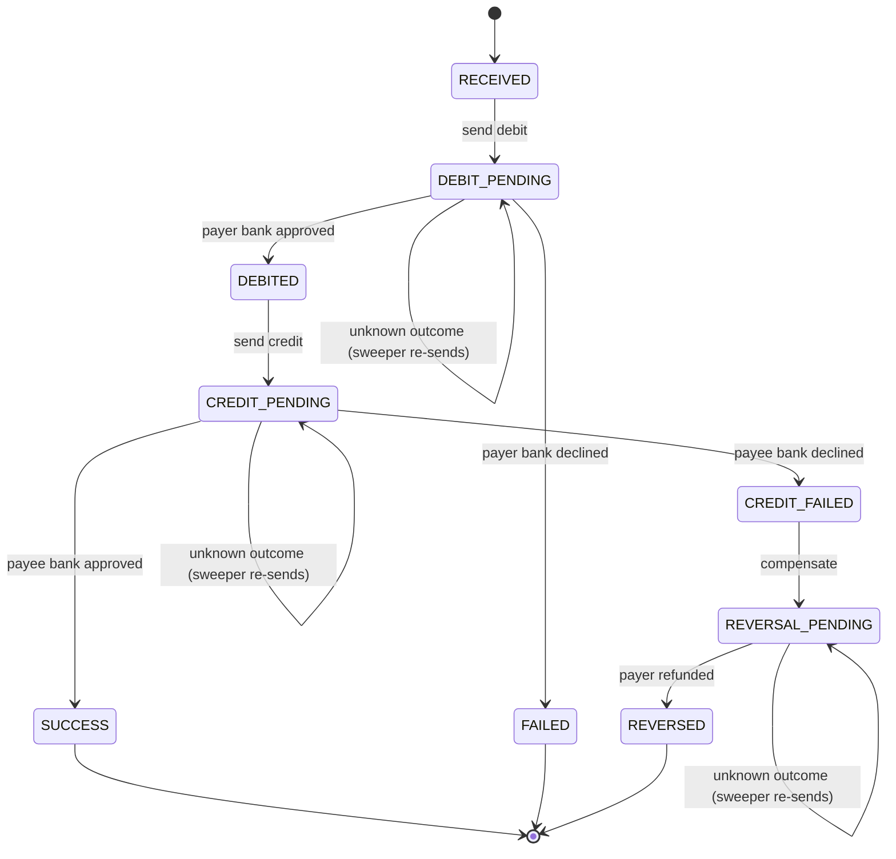

# Payment lifecycle

Every payment moves through a guarded state machine. Illegal transitions throw rather
than silently corrupting a payment, and the only terminal states are `SUCCESS`,
`FAILED` and `REVERSED` — a payment never ends with money stranded inside the switch.

## Why a saga rather than one transaction

The payer and payee are at different banks, reached over separate network calls. There
is no shared database transaction across them, so the switch uses the saga pattern:
do the debit, do the credit, and if the credit cannot be completed, run a
**compensating** reversal to undo the debit.

## The rule that matters most

A decline and a timeout are not the same thing.

* **Declined** is a definitive "no" from the bank. Nothing was applied, so the switch
  can act immediately — fail the payment, or reverse the debit.
* **Timeout** means the outcome is *unknown*. The leg may or may not have been applied.
  Reversing here could refund a payment that actually succeeded, and re-sending blindly
  could pay out twice.

So on a timeout the switch does nothing except leave the payment in its `*_PENDING`
state. The recovery sweeper later re-sends the identical leg, and because each bank is
idempotent per `(txnId, leg)`, the re-send returns the original outcome instead of
applying anything twice.
